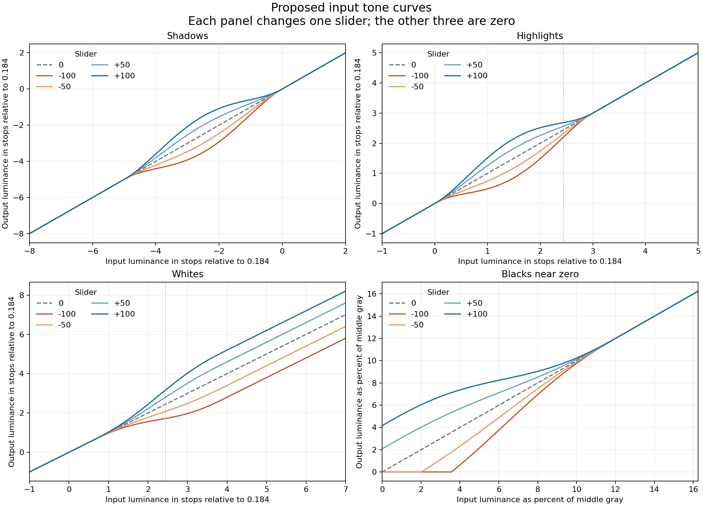

# Input tone controls design

Status: initial Rust CPU and WGPU implementation. Date: 2026-10-19.
Broader photographic evaluation and strength tuning remain open.

Add Highlights, Shadows, Whites, and Blacks controls for preparing a developed
digital photograph before spectral reconstruction and film simulation. The
controls use a luminance curve with explicit equations, bounded slider
strengths, and a monotonicity guarantee. Shadows, Highlights, and Whites
evaluate that curve on a regional base, an edge-aware smoothing of log
luminance, so texture inside a lifted or lowered region keeps its contrast
(see [Regional application](#regional-application)). CPU processing, WGPU
previews, and image exports implement the same regional operation; look LUT
exports bake the uniform-region curve.

The proposed first version combines three adjustments in exposure stops with
a separate adjustment near black. Positive Blacks can lift actual zero;
negative Blacks can deliberately clip the deepest tones. Whites changes the
upper exposure range while retaining values above one for the film simulation.
The numerical strengths below are starting values for visual evaluation.

## Intended behavior and Lightroom inspiration

Use Lightroom's familiar slider directions and tonal roles.
[Adobe's description of its Basic tone controls](https://helpx.adobe.com/lightroom-classic/desktop/process-and-develop-photos/image-tone-color.html)
distinguishes adjustments to bright and dark detail from changes to white and
black clipping. The formulas in this proposal are Spektrafilm's own design;
they do not reproduce Adobe's processing algorithm or slider numbers.

| Control | Negative values | Positive values | Proposed role before film simulation |
| --- | --- | --- | --- |
| Highlights | Darken bright detail | Brighten bright detail | Shape the range between middle gray and diffuse white, fading out just above white. |
| Shadows | Deepen dark detail | Lift dark detail | Shape the quarter tones while leaving true black and middle gray fixed. |
| Whites | Reduce upper exposure | Increase upper exposure | Move diffuse white and the bright tail, including HDR headroom. |
| Blacks | Map more deep tones to zero | Raise the deepest tones and black floor | Set the toe independently of the broader Shadows adjustment. |

Diffuse white means linear luminance `1.0`, which is `+2.44` stops above the
`0.184` middle-gray anchor. Most developed photographs, and every SDR input,
have little content above it. The regions below are placed around that point:
Whites, not Highlights, owns the white point.

These are input corrections. They affect the light reaching the simulated film,
including subsequent density, halation, and grain behavior. Film, paper, and
scanner settings continue to determine the final displayed black and white.
In particular, Whites is not a hard clamp at input RGB 1.0: doing that would
discard headroom before film exposure. Exact final output endpoints would require
an output adjustment with a separate place in the pipeline.

The first version applies to photo-to-film routes, including direct slide scans.
The `input` passthrough route and scanned-negative `convert-film` routes bypass
these controls. Retain the values when changing routes, and mark the section
unused through the existing inspector behavior. Lightroom catalog color edits
remain excluded; these are Spektrafilm edits.

## Pipeline placement and exposure accounting

The intended order is:

```text
RAW development and white balance, or input transfer decoding
    -> existing auto exposure and manual EV gain
    -> Shadows -> Highlights -> Whites -> Blacks
    -> spectral reconstruction and film exposure
    -> existing optical effects, development, print, and scan
    -> output color transform and encoding
```

Geometry and the existing preview resize policy retain their current order.
Tone processing does not trigger RAW development or alter stored source pixels.

Meter the image before the new tone adjustments. The existing meter may use
spectral film exposure to determine its gain; retain that metering definition.
Changing a tone slider must not cause auto exposure to compensate in the
opposite direction. The tone thresholds operate on RGB after the resulting
camera gain, so changing exposure can move image content between tonal ranges.

Keep two distinct gains in the implementation:

```text
camera_gain  = auto_exposure_gain * 2^camera.exposure_compensation_ev
filming_gain = existing B&W or slide filming exposure correction

film_raw = filming_gain * spectral_convert(tone(camera_gain * linear_rgb))
```

The existing resident GPU path folds both gains into its front-pass matrix.
When tone is active, only `filming_gain` can remain folded into that matrix;
`camera_gain` must act before the nonlinear tone curve. Applying the combined
gain after tone, or retaining it in the matrix after also applying it before
tone, would produce incorrect results. Preserve the current combined folding
path exactly when all four controls are zero.

Virtual reference exposures, stock calibration, neutral filter data, and
internal spectral LUTs exclude the new photo adjustments. They must not be
rebuilt or recalibrated to cancel a tone change. The fixed middle-gray anchor
also leaves the usual zero-EV gray reference unchanged. Existing print exposure
compensation remains a separate behavior and still affects the final image.

## Luminance and slider coordinates

Let `rgb` be linear input RGB after `camera_gain`. Use the selected input color
space's native RGB-to-XYZ matrix, before adaptation to the film illuminant:

```text
M = transfer::get(input_color_space).to_xyz
luma = M[1] / (M[1][0] + M[1][1] + M[1][2])
Y = dot(luma, rgb)
g = 0.184
e = log2(Y / g)                         # for Y > 0
```

Normalizing the row makes neutral RGB `(v, v, v)` have luminance `v`. Obtain
the matrix in f64, then convert its coefficients for the chosen backend. Do not
reuse a matrix containing exposure, film chromatic adaptation, or film channel
sensitivities: switching film stocks should not redefine input luminance
weights. A stock's existing effect on metered camera gain can still move
content between tonal ranges. Do not hard-code sRGB luminance weights for
every input color space.

`g` matches the pipeline's existing middle-gray reference. `e = -4` means
sixteen times less luminance than middle gray, and `e = +3` means eight times
more. Working in stops gives the controls useful reach in both dark RAW detail
and highlights above one.

Store four finite slider values in `[-100, 100]`. Normalize them linearly:

```text
s = shadows   / 100
h = highlights / 100
w = whites    / 100
b = blacks    / 100
```

Each normalized value is in `[-1, 1]`. All zero means an exact bypass. Reject
nonfinite or out-of-range persisted values through parameter validation.

## Curve equations

### Smooth regional weights

Define two small polynomials. In both equations, clamp the argument first:

```text
t = clamp(x, 0, 1)
B(x) = 16 * t^2 * (1 - t)^2
S(x) = t^3 * (10 - 15*t + 6*t^2)
```

`B` is a bell with value zero and derivative zero at both ends, and value one
at its center. It changes a region without changing values outside that
region. `S` is a smooth transition from zero to one, with zero first and second
derivatives at both ends. Outside `[0, 1]`, clamping makes `B` zero and `S`
constant at the corresponding endpoint.

### Shadows

```text
delta_s = 1.0 * s * B((e + 5) / 5)
e1 = e + delta_s
```

This operates between `-5` and `0` stops relative to middle gray. Its peak
effect is at `-2.5` stops (linear `0.0325`), in the quarter tones: Shadows
`+100` adds one stop there; `-100` subtracts one stop. The effect smoothly
returns to zero at the lower boundary and at middle gray. It does not raise
true zero or brighten the whole image. The peak sits above the Blacks toe,
which ends at `-3` stops, so the two controls overlap only in their tails.

For example, with the other sliders zero:

```text
Y = g * 2^-2.5 = 0.0325
Shadows +100: e = -2.5 -> -1.5; Y' = 0.0651
Shadows -100: e = -2.5 -> -3.5; Y' = 0.0163
```

### Highlights

```text
delta_h = 0.6495 * h * B(e1 / 3)
e2 = e1 + delta_h
```

This operates between `0` and `+3` stops, with its peak effect at `+1.5`
stops (linear `0.520`). The maximum change there is `+/-0.6495` stops. At
diffuse white the weight has fallen to `0.37`, so Highlights `+/-100` moves
white by only `+/-0.24` stops; Whites moves it by `+/-0.72`. Highlights
returns to the identity at `+3` stops, just above white.

The reach is modest because the curve can only change a narrow band of region
levels by flattening its neighbors. Reaching `+/-1.5` stops within these three
stops would drive the slope between regions below `1/3` (see the monotonicity
section). The regional base keeps texture inside each region from being
flattened, but it does not lift that limit between regions.

Shadows and Highlights meet at a fixed middle-gray anchor. Blacks overlaps
the bottom of the shadow range, and Whites overlaps the top of the highlight
range. This first version deliberately retains the anchor rather than using
image-dependent thresholds.

### Whites

```text
delta_w = 1.2 * w * S((e2 - 0.5) / 3.5)
e3 = e2 + delta_w
```

Whites begins at `+0.5` stops and reaches its full effect at `+4` stops. At
diffuse white (`+2.44` stops) the weight is `0.60`, so Whites `+100` adds
`0.72` stops to white. At and above `+4` stops it adds `1.2` stops. At the
Highlights peak (`+1.5` stops) its weight is only `0.14`. Negative values
compress the transition and reduce the bright tail; positive values expand it
and increase the tail.

There is no white clipping in this stage. Above the transition, the curve
becomes a constant exposure shift, retaining highlight ordering and headroom.
For example, a luminance of `1.0` becomes `1.650` under Whites `+100`, not
staying at `1.0`. The film response handles that exposure afterward.

### Applying the exposure adjustments to RGB

On positive luminance, the three operations define:

```text
F_shw(Y) = g * 2^e3
G = 2^(delta_s + delta_h + delta_w)
rgb1 = rgb * G
Y1 = Y * G
```

Evaluate the accumulated deltas for `G`; do not calculate `F_shw(Y) / Y` near
zero or recover a tiny delta by subtracting two very large log coordinates.
The shared positive gain preserves input RGB ratios and chromaticity. It does
not guarantee unchanged perceived hue after the nonlinear film response.
Negative RGB channels in a pixel with positive luminance retain their signs.

Shadows and Highlights act on opposite sides of the fixed gray anchor, so their
maximum gains do not accumulate on one pixel. Below gray the gain is within
`2^+/-1`. Above gray, Highlights and Whites can overlap, so a conservative
bound is `2^+/-(0.6495 + 1.2)`, approximately `[0.277, 3.604]`, across all slider
combinations; because their peaks are separated, the largest combined change
observed numerically is about `1.30` stops. This bound excludes the existing
camera exposure gain, which is applied before tone.

The normalized intervals use the output of the previous operation. In
particular, Whites evaluates `e2`, not the original `e`. This order is part of
the algorithm. A Highlights reduction can move a pixel into a weaker part of
the Whites mask. Changing execution scheduling must not change that behavior.

### Regional application

The equations above give the exposure change for a uniform region at level
`e`. A photograph is not uniform, and evaluating them on each pixel's own `e`
compresses texture wherever the curve's slope is below one. Shadows `+100`, for
example, has a stop-space slope of `0.39` one stop below gray, so a textured
surface lifted into that band loses most of its local contrast and reads as
mud. Instead, evaluate the three exposure deltas on a regional base `E` and
apply the resulting gain to the pixel:

```text
e   = log2(max(abs(Y), g * 2^-12) / g)       # per pixel, after camera_gain
r   = round(0.02 * max(width, height))       # at least 1
eps = 8                                      # stops^2

mean(x) = box mean over the in-bounds part of a (2r+1)^2 window
m  = mean(e)
v  = max(mean(e^2) - m^2, 0)
a  = v / (v + eps)
b  = m * (1 - a)
E  = mean(a) * e + mean(b)                   # self-guided filter (He et al.)

G   = 2^(delta_s + delta_h + delta_w evaluated at E)
rgb1 = rgb * G,  Y1 = Y * G                  # Blacks then uses Y1 per pixel
```

Where the window holds only small variation (`v << eps`), `a` is near zero
and `E` is the regional mean: every pixel in the region receives the same
gain, so texture keeps its contrast exactly in stops. Across a strong edge
(`v >> eps`), `a` approaches one and `E` follows the pixel, so the two sides
take their own gains rather than bleeding into each other. `eps = 8` treats
variation up to roughly `sqrt(8) = 2.8` stops as texture; rough material such
as rock, foliage, and fur varies by more than half a stop, and a smaller
`eps = 0.25` let those surfaces fall back to the per-pixel curve. In a uniform
region `E = e` and the operation equals the per-pixel curve.

The radius is a fraction of the long edge of the image reaching film
exposure, after crop and preview resizing, so a preview and a full-resolution
export select the same regions. Blacks stays per pixel: it sets a floor and a
clip point near zero, which are defined on actual pixel values. When only
Blacks is active, the base is not computed. Invalid pixels are left
unchanged and contribute middle gray to their neighbors' base.

Pixels with the same luminance can now receive different gains, so the
operation is no longer a single function of luminance. Its guarantees are per
region: the uniform-region curve is monotonic with the slope floors below,
texture inside a region keeps its stop-space contrast, and gains between
regions differ by at most the curve's own range. The guided filter's edge
behavior keeps halos small; visual evaluation must still check backlit edges.

### Luminance-only region selection

The masks classify a pixel by its weighted luminance alone. Saturated colors
whose dominant channel has a small luminance weight are therefore placed
lower than their brightest channel suggests. In linear sRGB, a bright blue
`(0.02, 0.03, 0.60)` has `Y = 0.069`, `-1.41` stops, so Shadows `+100` treats
it as a shadow and lifts it `0.66` stops, taking its blue channel from `0.60`
to `0.95`. Highlights and Whites, conversely, under-select saturated blue and
red highlights. Neutral and low-saturation content is classified as intended.
The regional base averages the same luminance coordinate, so a saturated
patch is classified by its region's luminance rather than per pixel.

This is an accepted trade-off of the first version: luminance keeps the gain
a function of one scalar, which is what makes the monotonicity guarantee and
the chromaticity preservation hold. Visual evaluation must specifically check
saturated skies, colored lights, and neon. If the misclassification is
objectionable, evaluate a mask coordinate that blends luminance with the
maximum channel, such as `V = max(Y, k * max(r, g, b))` with `k < 1`, as a
separate change. On neutral pixels `V = Y`, so the gray anchor and the curves
above are unchanged, but the monotonicity argument must then be restated in
terms of `V`.

### Blacks and the black floor

Let `Y1` be the luminance after the three exposure adjustments. For nonnegative
luminance, define:

```text
K = g / 8 = 0.023                      # upper end of the black toe, -3 stops
A = K / 3 = 0.00767                   # maximum black offset, -4.58 stops
q = 1 - S(Y1 / K)
F_b(Y1) = max(0, Y1 + b*A*q)
```

At or above `K`, `q` is zero and Blacks has no effect. Below that level, the
offset fades in smoothly. Blacks `+100` maps true black to `A`, about `4.2%`
of middle gray; Blacks `-100` maps the deepest tones to zero. The latter clips
luminances up to approximately `0.00656` when the other sliders are zero,
about `-4.81` stops relative to middle gray.

Blacks acts last so its raised floor is not subsequently moved by Shadows.
It also lets a Shadows lift retain a deliberate deep black using negative
Blacks. Unlike the other operations, negative Blacks intentionally introduces
a flat clipped region. Its clipping threshold is continuous but has a slope
change; the smooth support boundary at `K` is unaffected.

RGB application separates lifting from darkening:

```text
b > 0: rgb2 = rgb1 + (b*A*q) * (1, 1, 1)
b = 0: rgb2 = rgb1
b < 0: rgb2 = rgb1 * max(0, Y1 + b*A*q) / Y1    # when Y1 > 0
```

A positive black floor requires a neutral addition: multiplying zero cannot
raise it. This also reduces saturation near the raised floor, as colors move
toward neutral. Claim chromaticity preservation for the shared exposure gain
and negative Blacks scaling, not for the positive Blacks branch. The negative
branch's gain is in `[0, 1]`, so darkening does not create an unbounded division.
The zero and signed cases below complete these equations.

### Zero and signed luminance

Use an explicit extension for numerical and wide-gamut inputs:

1. For the exposure operations, evaluate the masks on `abs(Y)` and apply the
   resulting positive gain to all RGB channels. For `Y = 0`, use `G = 1`.
   This gives an odd luminance extension and never takes `log2(0)`.
2. For Blacks, calculate `q = 1 - S(abs(Y1) / K)`.
3. For positive Blacks, use the same neutral addition for either sign of `Y1`.
4. For negative Blacks and `abs(Y1) > 0`, use the bounded gain
   `max(0, abs(Y1) + b*A*q) / abs(Y1)`. At `Y1 = 0`, use gain zero.
5. When Blacks is zero, skip its arithmetic. When all controls are zero, skip
   the entire tone stage before inspecting or rewriting any pixel.

Consequently, an exact black pixel stays black unless Blacks is positive. A
nonzero RGB vector whose weighted luminance cancels to zero also has a defined
result: negative Blacks maps it to zero; positive Blacks adds the neutral
floor. No individual channel is clamped into `[0, 1]` by these rules.

The log coordinate uses a floor of `g*2^-12`, so zero and subnormal
luminances have a finite `e` that the box means can average. All three masks
are already zero below `-5` stops, so the floor does not change any gain. For
`e >= 4`, Shadows and Highlights have no effect and Whites supplies its
constant tail gain.

The equations assume finite RGB values and finite positive camera gain.
Retain the renderer's existing treatment of invalid image data; do not conceal
NaNs or infinities by introducing channel clipping in this stage.

## Why the combined curve is monotonic

This section concerns the uniform-region curve: the response to a region at
one level, and the per-pixel operation used for LUT bakes. With the regional
base, the slopes below govern how region levels map to each other; texture
inside a region keeps its own contrast.

A naive sum of four exposure masks can make the total derivative negative
when controls combine. That would reverse the ordering of nearby
tones. This design composes individually monotonic functions instead.

For the bell polynomial on `[0, 1]`:

```text
B'(t) = 32*t*(1 - t)*(1 - 2*t)
max(abs(B'(t))) = 16*sqrt(3)/9 = approximately 3.07920
```

Therefore, over the complete slider ranges:

```text
d(e1)/d(e)  >= 1 - (1.0 / 5) * 3.07920 = approximately 0.384
d(e2)/d(e1) >= 1 - (0.6495 / 3) * 3.07920 = approximately 0.333353
```

For the transition polynomial:

```text
S'(t) = 30*t^2*(1 - t)^2
0 <= S'(t) <= 15/8

d(e3)/d(e2) >= 1 - (1.2 / 3.5) * (15/8) = approximately 0.357
```

For positive Blacks, the smallest derivative is:

```text
d(F_b)/d(Y1) >= 1 - (A / K) * (15/8) = 0.375
```

Monotonicity alone is not the design target. A slope near zero is still
ordered but collapses a band of tones into nearly one value, which reads as a
flat or posterized patch after the film curve. Every single slider is
therefore held to an unclipped slope of at least `1/3` in its own coordinate:
exposure stops for Shadows, Highlights, and Whites, and linear luminance for
Blacks. Either sign can compress one part of a bell-shaped curve while
expanding another. The maximum slopes in these coordinates are at most `1.67`.

For the three exposure controls, overlapping regions multiply their stop-space
slopes. Their worst case is Highlights `+100` with Whites `-100`, whose steepest compressions
both fall near `+2.3` stops; there the combined slope is about `0.14`. This
remains strictly increasing and requires deliberately contradictory sliders.

That `0.14` bound does not include Blacks. For a complete luminance transform
`F`, the stop-space slope is `Y/F(Y) * F'(Y)`. Positive Blacks raises zero to
a finite floor, so its stop-space slope approaches zero near black even though
its linear-luminance slope stays above `1/3`. For example, Blacks `+100` alone
has a stop-space slope of about `0.085` at `Y = 0.00071875`. The complete
four-control transform has no positive stop-space contrast floor. Visual
evaluation must check this expected contrast reduction separately.

For negative Blacks the unclipped derivative is at least one; `max(0, ...)`
adds the intentional flat region. The signed extension is also nondecreasing
in luminance. Since conversion from positive linear luminance to stops and
back is monotonic, the composition preserves luminance ordering for every
slider combination. It is strictly increasing except where negative Blacks
deliberately clips.

The smooth boundaries have matching first derivatives. Thus mask boundaries
do not introduce slope discontinuities; the intentional black clipping knee
is the exception. The regional base is a neighborhood filter; its edge
behavior is described under [Regional application](#regional-application).

Changing strengths or interval widths requires preserving the bounds above.
Strict monotonicity needs a bell adjustment of amplitude `a` over width `L`
to satisfy `abs(a)/L < 9/(16*sqrt(3))`, about `0.325`, and a transition to
satisfy `abs(a)/L < 8/15`. The `1/3` slope floor is the tighter rule used
here: `abs(a)/L <= sqrt(3)/8` for a bell, `abs(a)/L <= 16/45` for a transition,
and `A/K <= 16/45` for Blacks. These exact bounds are approximately `0.216506`
and `0.355556`; rounded values must not relax the bounds. The selected
Highlights amplitude `0.6495` stays below the maximum `9/(8*sqrt(3))` for
its three-stop interval. Tune within these limits. These are algorithm
constraints, not performance scheduling parameters.

## Curve plots and numerical examples



The panels show the uniform-region curve. The first three use stops relative
to `g = 0.184` on both axes; the dotted line marks diffuse white. Blacks uses linear luminance near zero,
expressed as a percentage of middle gray, so the raised floor and clipped
region remain visible. Each panel varies one slider with all other controls
zero. These show the input transform before any film, paper, or scanner
response.

| Settings | Input luminance | Output luminance | Exposure change |
| --- | ---: | ---: | ---: |
| Shadows +100 | 0.032527 | 0.065054 | +1 stop |
| Shadows -100 | 0.032527 | 0.016263 | -1 stop |
| Highlights +100 | 0.520431 | 0.816360 | +0.6495 stops |
| Highlights -100 | 0.520431 | 0.331775 | -0.6495 stops |
| Highlights +100 | 1.0 | 1.179415 | About +0.238 stops |
| Whites +100 | 1.0 | 1.650132 | About +0.723 stops |
| Whites -100 | 1.0 | 0.606012 | About -0.723 stops |
| Whites +100 | 2.944 | 6.763536 | +1.2 stops |
| Blacks +100 | 0 | 0.007667 | Raised floor |
| Blacks -100 | 0.003833 | 0 | Clipped |
| Shadows +100, Blacks -100 | 0.0115 | 0.013638 | About +0.246 stops |
| Highlights -100, Whites +100 | 0.520431 | 0.334155 | About -0.639 stops |

Middle gray maps to itself for every combination: Shadows and Highlights are
zero at `e = 0`, Whites begins above it, and Blacks ends below it. This is a
property of the tone stage, not a promise that every final film render maps
middle gray to the same output RGB.

The intervals and strengths are explicit proposed constants. They are not
camera measurements or inferred Lightroom coefficients. Evaluate them on
photographs before freezing them as the first shipped rendering behavior.

## Parameters and interface integration

Add a small `ToneParams` group under `CameraParams`, serialized as
`/camera/tone`, containing `highlights`, `shadows`, `whites`, and `blacks`.
Use the existing parameter scalar convention for stored slider values and
neutral defaults for missing fields. The calculation uses the build's image
precision, with f64 constants and coefficients retained on the f64 CPU path.

Add a Tone section in the Input tab, adjacent to Exposure, in the visible
order Highlights, Shadows, Whites, Blacks. Reuse the current slider widget,
numeric entry, reset gesture, changed-state indication, and drag history
coalescing. All four sliders start at zero and use `[-100, 100]` with a step
of one. Tooltips explain the targeted tones, the input placement, and the
neutral floor produced by positive Blacks.

Register the parameter group with the inspector's section pointers and
existing edit selection system. Cover project save/load, catalog photo edits,
undo/redo, reset, defaults, presets, and selected-settings copy/paste. Older
saved projects lacking the group load neutral tone values and use the exact
tone-stage bypass.
Changing film stock must not replace these photo edits with stock settings.

## Processing integration

The implementation uses the following locations.

| Area | Integration |
| --- | --- |
| [Runtime parameters](../crates/spektrafilm-core/src/params.rs) | Add the neutral tone group and validation. |
| [Math crate](../crates/spektrafilm-math/src/lib.rs) | Add a small pure tone evaluator with explicit luminance weights, f32/f64 support, and scalar reference tests. |
| [CPU filming](../crates/spektrafilm-core/src/stages/filming.rs) | Apply tone to the existing mutable linear RGB working image after camera EV and before spectral conversion. |
| [Pipeline](../crates/spektrafilm-core/src/pipeline.rs) | Separate camera and filming gains for an active tone stage; preserve current metering, calibration, tap, and bypass semantics. |
| [GPU interface](../crates/spektrafilm-gpu/src/lib.rs) | Pass optional prepared tone uniforms, unadapted luminance weights, and the camera gain into the resident chain. |
| [WGPU backend](../crates/spektrafilm-gpu/src/wgpu_backend.rs) | Dispatch tone after input decoding and before the spectral front pass. |
| [GUI controls](../crates/spektrafilm-gui/src/main.rs), [inspector](../crates/spektrafilm-gui/src/inspector.rs), and [tooltips](../crates/spektrafilm-gui/src/tooltips.rs) | Add controls and route usage, edit tracking, and descriptions. |
| [Catalog edits](../crates/spektrafilm-gui/src/catalog_edits.rs), [projects](../crates/spektrafilm-gui/src/project.rs), and [CLI](../crates/spektrafilm-cli/src/main.rs) | Verify serialization and parameter propagation, including the separate f64 export process. |

### CPU and precision

Apply tone to the existing working RGB buffer in `filming::expose`, once,
when the image reaches film exposure. The regional base needs temporary
full-frame storage of five scalars per pixel (`e` and two pairs of box means),
freed before spectral conversion. Box means use running sums along rows and a
transpose, so their cost does not grow with the radius. Accumulators are f64.
The outer auto-exposure recursion and input decoding already account for
their own work; they must not cause tone to run twice.

Use the unmodified input for metering. Reference midgray calibration and the
neutral-print optimizer explicitly disable photo tone controls, including
when manual EV has shifted their reference away from the fixed tone anchor.
Photographic calibration strips retain the selected photo edits so that they
still preview the current image under different exposures or print settings.

The f64 helper receives the same serialized parameters and evaluates the same
equations in f64, without routing through a sampled f32 tone LUT. The default
CPU path uses the project's normal image precision. Do not add a separate
approximation for dragging sliders.

### WGPU and other backends

The WGPU stage runs on the resident input RGB buffer after the existing input
transfer pass, which decodes encoded RGB first. RAW input is already linear
and skips the transfer decode as today. The spectral front matrix then
contains only its existing color conversion, adaptation, and `filming_gain`.

One shader with a stage index runs five dispatches: log luminance, horizontal
and vertical box means of `(e, e^2)` with the guided coefficients, horizontal
and vertical box means of `(a, b)`, then camera gain and tone on the image.
When only Blacks is active, a single per-pixel dispatch replaces them. The
chain's output buffer is free until the front pass and holds `e` and the
coefficients; one extra buffer of two floats per pixel holds the box-mean
pairs. Box means sum `2r+1` taps directly in f32. There is no readback,
upload of modified pixels, or synchronization with CPU processing. Respect
the existing dispatch bounds, scheduler admission, cancellation, and yield
boundaries. Reuse compiled shader state across slider values.

Zero tone retains the existing exposure folding and dispatch sequence, with
no new pass. For a backend such as experimental CUDA that lacks the stage,
decline the resident path before dispatch and use the correct shared path.
An enabled control must never silently disappear because a backend lacks it.

The equations define the algorithm; a separate pass versus a validated fused
implementation defines execution. This follows the separation in the
[processing optimization design](processing-optimization-design.md). Fusing
decoding, camera gain, tone, or the front pass is a later measured optimization
and must preserve their order. This feature does not implement the proposed
scheduling or autotuning system.

### Routes and intermediate taps

Gate the stage on the same camera-route condition used by the inspector.
Injected `rgb_in` or `rgb_pre` runs tone once when reaching film exposure;
injection at film log exposure or later bypasses it. Preserve `rgb_pre` as
the existing pre-exposure boundary. Adding a new public tap is unnecessary
for this feature; the pure tone evaluator supplies isolated stage tests.

Image exports use the same route and parameters as the corresponding render.
A LUT lattice has no image space, so LUT bakes (`debug.lut_mode`) apply the
uniform-region curve per pixel in the first RGB-to-film stage. A LUT
therefore matches a render on large uniform areas and does not reproduce the
regional preservation of texture. In a segmented LUT bundle, include it exactly once in the
segment crossing that stage; downstream segments consuming film exposure
must not repeat it. Internal reconstruction and calibration LUTs exclude it.
Test LUT approximation around the deliberate black clipping knee using the
existing export quality checks.

## Invalidation and memory behavior

| Cached work | On a tone edit |
| --- | --- |
| Decoded RAW and geometry | Reuse; no reload or reframe. |
| Resized preview input | Reuse at the existing requested size. |
| Auto-exposure meter result | Reuse, since its image and dependencies are unchanged. |
| Film/paper profiles, spectral LUTs, and calibrated pipeline data | Reuse; tone is excluded from their calibration key. |
| Prepared luminance weights | Reuse until the input color space changes. |
| Compiled GPU pipelines | Reuse; slider values are uniforms rather than shader variants. |
| Regional base | Recompute with each render; it is not cached. |
| Rendered image and display result | Invalidate and render with the latest tone values. |

`Pipeline::with_params` must update the runtime tone values while preserving
eligible calibrated data. Compare cached pipeline rendering against a fresh
pipeline for every new setting. Reuse the existing bounded caches; add no
per-slider cache or history of full-frame tone intermediates.

## Validation and acceptance criteria

### Mathematical and stage tests

The equations have analytical slope bounds. An f64 NumPy evaluation of the
scalar curve reproduced the single-slider floors above, the numerical
examples, the Blacks clipping threshold, and the combined worst case over a
grid of slider settings. The curve plot and example table come from these
equations. This was a design check, not a committed test; the implementation
tests below replace it.

Implementation needs:

- Exact all-zero bypass tests on RGB data, including signed zero, negative
  channels, HDR values, and the existing rendering path.
- Values and derivatives at every support boundary, plus numerical examples
  above, slider sign behavior, monotonicity, the `1/3` single-slider slope
  floor, and the explicit clipping region.
- Neutrality, chromaticity preservation for the multiplicative operations,
  and the intended saturation change under positive Blacks.
- Zero, tiny luminance, mixed-sign RGB, zero-luminance nonzero RGB, and
  multiple input primaries. Validate parameters before they reach shaders.
- Regional behavior: uniform regions equal the per-pixel curve; a textured
  region lifted into the curve's compressed band keeps its stop-space
  contrast while the per-pixel curve flattens it; pixels far from a hard edge
  take their own side's gain and the edge keeps its order; Blacks alone and
  LUT bakes stay per pixel; invalid pixels stay unchanged.
- CPU f32 and WGPU comparison against f64 on the same prepared pixel values.
  The per-pixel curve starts with a stage error budget of
  `2e-7 + 2e-5*abs(reference_channel)`. The regional stage sums box means in
  f32 on the GPU and f64 on the CPU; its budget is
  `1e-6 + 2e-4*abs(reference_channel)`. Assess cancellation cases separately.
  Confirm the budget on supported adapters rather than treating it as a
  measured guarantee. Check final renders as well, since film can amplify
  small stage differences.

### Integration tests

- Old project and preset compatibility, new settings round trips, catalog
  photo switching, history coalescing, reset, and selected-settings copy/paste.
- Camera routes, slide and negative stocks, print compensation on and off,
  passthrough and conversion bypass, and intermediate tap injection.
- Correct placement relative to encoded input decoding, metering, manual EV,
  filming correction, and spectral conversion. Verify no doubled gain.
- Fresh versus cached pipelines, unchanged meter/calibration keys on tone
  edits, and changed luminance weights on input color-space changes.
- Full-resolution CPU and WGPU image exports, the separate f64 helper, and
  complete and segmented look LUT exports.

Compare backends at the same resolution and with the same prepared input.
The regional radius scales with the image, so previews and exports select the
same regions, but a filter at preview resolution still differs in detail from
one at full resolution. Preserve the existing preview policy rather than
treating that difference as a tone backend error or adding a lower-quality
drag approximation.

### Visual evaluation

Use available originals from the user's catalog and dedicated examples of
bright skies, backlit subjects, dark textured material, skin, foliage, saturated
lights, and neutral gradients. Inspect moderate changes and the extremes,
especially Shadows positive with Blacks negative, Highlights negative with
Whites positive, and Highlights positive with Whites negative. Check whether
Highlights has enough reach at its reduced strength, whether Whites alone
gives satisfactory control of the white point on SDR inputs, and how
saturated blue and red content is classified. Include color negative and slide stocks, and inspect
grain and halation with both ordinary and HDR highlight values.

Decide whether the proposed region widths and strengths feel useful before
shipping. A lift can still reveal shadow noise or make a lifted black floor
look gray; the derivative proof establishes ordering, not visual quality.
Inspect backlit edges at 100% for halos from the regional base, and check
whether the radius and `eps` select sensible regions on small subjects.

### Performance evaluation

Measure the complete slider interaction, including rendering and display,
with neutral and nonzero settings on representative catalog RAWs and existing
preview sizes. Record cold and warm renders, CPU f32/f64 timings, WGPU pass
cost, and full-resolution export cost. Keep the selected resolution and image
quality settings fixed.

Rendering a tone edit must not decode RAW again, rebuild spectral calibration,
compile shaders, or reread source/profile file contents. Existing calibration
fingerprint metadata checks and saving edit/history after a gesture retain their
normal behavior. The neutral case
adds no dispatch or image allocation. The active WGPU case stays resident;
the CPU case reuses its existing working RGB buffer. Establish measured latency
before considering fusion or a tone LUT. Such optimizations need their own
error and monotonicity checks and cannot change the formulas by accident.

## Implementation sequence

1. Add the pure evaluator, parameter validation, and reference tests. Freeze
   the numerical contract for the first visual trial.
2. Integrate CPU film exposure, gains, calibration exclusions, and tap behavior.
3. Add the resident WGPU stage and correct fallback behavior; establish stage
   and final-render agreement before exposing the controls.
4. Add the interface, edit persistence, history, and export propagation together.
5. Evaluate real photographs, tune constants within the `1/3` slope-floor
   limits, and measure slider latency before accepting the feature.

The design does not add segmentation, local masks, automatic tone selection,
RAW highlight reconstruction, or output tone controls. It shapes detail retained
in the developed RGB; it cannot reconstruct sensor information lost in every
channel.

## Regional base evaluation

The per-pixel curve compressed textured shadows into mud. A blind A/B
evaluation on five photographs from the user's catalog chose shadows-heavy
RAWs: a backlit ridge, a cow in dappled shade, black lava rock, a sandstone
canyon, and a black dog. Each was rendered at `0.3x` through Kodak Portra 400
and its default print with Shadows `+100`, comparing the per-pixel curve with
alternatives in random order.

| Round | Alternative | Per-pixel curve | Alternative | Tie |
| --- | --- | ---: | ---: | ---: |
| 1 | Per-pixel shelf (constant deep lift) | 3 | 1 | 1 |
| 2 | Regional shelf, `eps = 0.25` | 3 | 2 | 0 |
| 3 | Regional shelf, `eps = 8` | 3 | 2 | 0 |
| 4 | Regional bell (this design), `eps = 8` | 1 | 3 | 1 |

Detail was measured as mean `abs(log2 Y - blur(log2 Y))` with a 3-pixel
Gaussian, per band of the original's luminance percentiles, relative to the
untoned render, averaged over the five photographs:

| Percentile band | Per-pixel curve | Regional (this design) |
| --- | ---: | ---: |
| 0-10% | 132% | 120% |
| 10-25% | 133% | 124% |
| 25-45% | 101% | 109% |
| 45-65% | 81% | 99% |
| 65-100% | 78% | 90% |

Two findings shaped the design. The shelf shape lifted black subjects (the
lava rock, the dog's coat) toward gray and lost every photograph with them;
the bell shape leaves the deepest tones nearly unchanged. And `eps = 0.25`
treated rough texture as edges, so those surfaces fell back to the per-pixel
curve. The per-pixel curve's extra deep-shadow contrast still won the backlit
ridge, a near-silhouette. This is one rater on five photographs; the
direction is clear, the constants are not final.

## Initial implementation verification

This section records the per-pixel implementation that preceded the regional
base. The regional base kept its gain placement, bypasses, and calibration
exclusions; its CPU result matched the evaluated prototype exactly, and on a
`2102 x 1402` RAW render its WGPU output differed from the CPU by `1.75/255`
mean against `1.65/255` with tone neutral.

The shared evaluator and resident WGPU pass implement the equations above,
including the corrected Highlights amplitude `0.6495`. Camera exposure acts
before tone; scanner filming correction remains afterward. Zero tone bypasses
the new processing, and tone edits reuse decoded inputs, metering, spectral
calibration, and compiled shaders.

Validation on an Apple M1 Max included:

- Default workspace tests: 284 passed, 5 ignored.
- The f64 workspace: 294 passed, 5 ignored.
- Four focused f64 curve tests with a `2e-12` reference-value tolerance.
- Seven catalog edit/history tests after adding upgrade coverage. Missing and
  partial tone groups in old history snapshots gain neutral defaults without
  creating a new edit or discarding Redo. Saved values and unknown keys survive
  the merge.
- Shader comparisons across input primaries and camera gain, plus complete
  renders with linear input, encoded metering, and a corrected slide scan.
  The synthetic complete-render differences were below `0.000009` linear RGB.
- Project and photo edit round trips, copy/paste and undo, fresh versus cached
  pipelines, bypass routes, segmented transforms, and complete look LUT bakes.
- Release builds of the GUI, regular CLI, and separate f64 export helper.

The corrected-slide test exposed a pre-existing scan fallback issue: enabling
scanner white/black correction silently used a coarse 3D LUT even when scanner
LUTs were disabled. That fallback now integrates scan XYZ directly. Its maximum
CPU/GPU difference in the test fell from about `0.0027` to below `0.000009`.
This independent correction can improve CPU renders even with neutral tone;
an explicitly enabled scanner LUT retains its existing path.

An available `7008 x 4672` catalog RAW was developed and exported through the
f64 helper at `2048 x 1365` with Shadows `65`, Highlights `-60`, Whites `25`,
and Blacks `-15`. The rendered scene includes a bright sky, backlit subjects,
vegetation, and dark foreground detail. Broader photographic tuning remains open.
On the same prepared photograph, complete CPU f64 and WGPU output buffers were
finite across all 8,386,560 channels. Maximum encoded-sRGB difference was
`0.0000613`, with RMS difference `0.00000754`, before file quantization.

Warm render timing used linear EXR inputs prepared from that RAW, Kodak Gold
200 and Portra Endura, with spatial and stochastic effects disabled in both
conditions. Each condition had 22 warm samples from two processes, alternating
condition order and excluding each process's cold frame.

| Input size | Neutral median | Tone enabled median |
| --- | ---: | ---: |
| 640 x 427 | 7 ms | 6 ms |
| 2048 x 1365 | 31 ms | 29 ms |

These coarse millisecond timings include the CLI's input clone, GPU processing,
and readback, and exclude decoding, calibration, file writing, and GUI display.
The observed ranges overlap; the lower tone medians do not establish a speedup.
No resolution or effect-quality setting changed between the paired conditions.
CUDA uses the shared processing fallback for tone; CUDA hardware, other operating
systems, and manual interaction in the native GUI were not exercised here.
