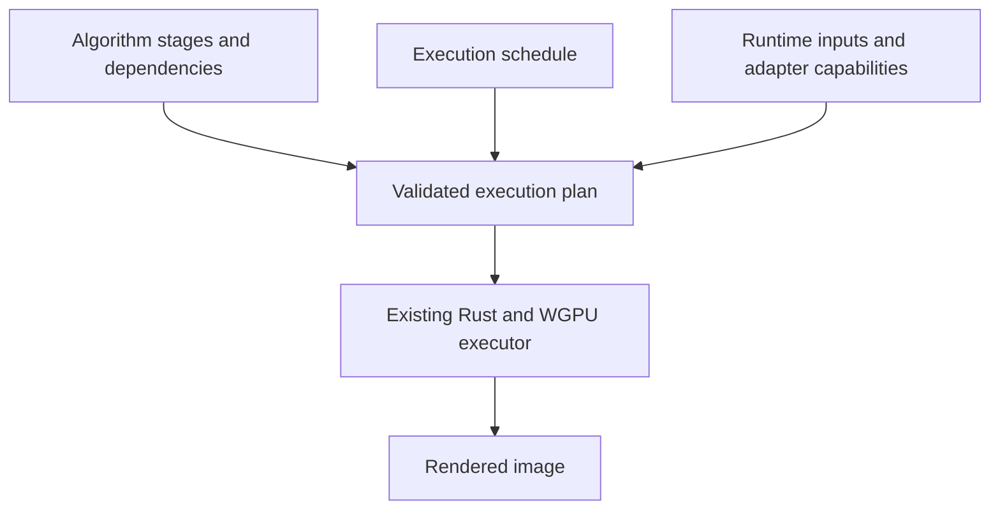

# Image processing optimization design

Status: proposed. Date: 2026-10-17. Implementation is deferred.

Improve Spektrafilm's image processing through measured changes to execution,
memory use, and GPU scheduling while preserving image quality and interactive
responsiveness. Take inspiration from Halide's separation of an image algorithm
from its execution schedule, using the existing Rust, Rayon, WGPU, and WGSL
implementation.

Make the algorithm, execution schedule, and executor explicit parts of the
design. Scheduling controls would be added incrementally behind that boundary,
starting with a baseline schedule and measurements, then a small offline sweep
of GPU workgroup sizes. Later controls would cover buffer reuse, combining
compatible passes, and filter tiling. Each experiment must demonstrate a useful
gain in the actual application workflow before becoming a production default.

## Motivation and Halide inspiration

Recent improvements have come from running independent pixels in parallel and
reusing work whose inputs have not changed. These improvements preserve the
processing model. A systematic sweep would extend that approach beyond finding
and optimizing individual loops by hand.

Halide makes the distinction between an algorithm and a schedule explicit:

| Algorithm decisions | Scheduling decisions |
| --- | --- |
| Color transforms, spectral integration, and interpolation | Which independent pixels or rows run together |
| Blur kernels, boundaries, and filter order | Tile dimensions and use of local memory |
| Grain distribution, seeds, and normalization | Thread mapping and placement of intermediate results |
| Precision and rounding requirements | Whether compatible stages share a kernel or a buffer |

Halide's [scheduling tutorial](https://halide-lang.org/docs/tutorial/lesson_08_scheduling_2.html)
explains the tradeoffs between storing intermediate images, recomputing values,
and processing tiles. Its [autoscheduling tutorial](https://halide-lang.org/docs/tutorial/lesson_21_auto_scheduler_generate.html)
demonstrates choosing a schedule for an explicitly described pipeline. Those
ideas motivate this design: an algorithm describes the computation, a schedule
describes execution choices, and an executor binds those choices to the existing
implementations. Spektrafilm would use a bounded set of hand-authored WGSL
variants and measured results to choose among them.

This proposal adds no Halide compiler, runtime, DSL, or WebGPU integration. It
also does not attempt to build a general image compiler or automatically rewrite
arbitrary Rust and shader code. The initial tuner would be a developer tool;
opening a photo or starting the app would not trigger an optimization search.

## Current architecture

These are the starting points in the current source, rather than new features
proposed by this design:

| Area | Existing behavior and relevant code |
| --- | --- |
| RAW development | [Shared I/O](../crates/spektrafilm-io/src/lib.rs) delegates decoding and development to Rawler or optional LibRaw. Lensfun correction and Lightroom geometry are separate operations. |
| Calibration and processing | [Core pipeline](../crates/spektrafilm-core/src/pipeline.rs) prepares spectral and color data and selects shared or resident processing. GUI caches reuse eligible pipelines, scaled inputs, and meter results. |
| GPU execution | [WGPU backend](../crates/spektrafilm-gpu/src/wgpu_backend.rs) runs a resident film chain with multiple compute passes and image buffers. Several per-pixel shaders and host dispatches use a fixed workgroup size of 1024. |
| Spatial effects | [Spatial processing](../crates/spektrafilm-gpu/src/spatial.rs) implements channel-aware FIR and recursive IIR filters. [FFT diffusion](../crates/spektrafilm-gpu/src/fft_diffusion.rs) has a separate execution path. |
| Resource reuse | Compiled pipelines, diffusion resources, and [display preparation buffers](../crates/spektrafilm-gpu/src/preview.rs) already have caches. Other resources are prepared within a render call. |
| Foreground responsiveness | The [scheduler](../crates/spektrafilm-gpu/src/scheduler.rs) has separate CPU and GPU lanes, task priorities, cancellation, and cooperative GPU yield points. |
| Measurements | Existing timers cover calibration and broad render phases. Compute passes currently omit GPU timestamp writes, so host elapsed time does not identify the cost of each GPU pass. |

GPU rendering uses f32; the f64 CPU export path remains a separate precision
option. This design preserves that distinction. It also preserves the selected
preview resolution, effect settings, and full-resolution export behavior.

## Proposed algorithm and schedule separation

| Part | Responsibility | Changes when |
| --- | --- | --- |
| Algorithm and dependencies | Identify logical stages, their inputs/outputs and dependencies, and their numerical contracts: color spaces, precision, interpolation, boundaries, reductions, and stochastic behavior. | The selected workflow or image-processing model requires different operations. |
| Execution schedule | Choose supported implementations, workgroup/tile sizes, placement and reuse of intermediates, and explicitly supported combinations of stages. | A tuning experiment or a validated execution policy selects a different way to run the same algorithm. |
| Executor | Validate and bind the algorithm and schedule into an execution plan, then dispatch existing Rust/WGPU implementations with their resources and runtime inputs. | A new scheduling control needs backend support. |



The algorithm description would identify stages and their contracts, without
re-expressing every numerical formula in a new language. Existing Rust/WGSL
implementations provide the calculations, with reference tests preserving their
correctness requirements. Build the description from the same workflow
preparation that selects the current
processing path; do not maintain a second, independently reconstructed pipeline.
Initially describe only the boundaries needed by the selected experiments and
retain the existing execution path for the remaining stages.

Photo parameters remain algorithm inputs. Exposure, film/paper selection, blur
amounts, grain settings, and the selected resolution are not tuning controls.
Some parameter changes legitimately select a different set of logical stages;
resolve that algorithm first and hold it and its inputs fixed while comparing
schedules. A schedule cannot remove an enabled effect or reorder dependent
operations to improve timing.

The schedule would be a small explicit configuration for named stages or
supported stage groups. An omitted control uses that stage's baseline behavior.
The executor is the single place that binds these choices to shader variants,
dispatch geometry, cache identity, and buffer lifetimes. GUI controls and numeric
implementations should not acquire independent copies of tuning policy.

The validated execution plan preserves dependencies, intermediate taps,
resource ownership, and required synchronization. Reject unsupported combinations
before dispatch and retain the existing valid path. This execution schedule is
distinct from the existing task scheduler: foreground priorities, admission,
cancellation, and GPU yield behavior continue to govern when jobs may run.

### Example of changing a schedule

Where input transfer decoding and RGB-to-RAW conversion are enabled and adjacent,
the algorithm still requires decoding followed by spectral conversion. A baseline
schedule would run their existing passes. A second schedule could change only
the conversion workgroup size. A later schedule could select an explicit fused
implementation for that pair, preserving their order and precision contracts.

The fused implementation would be written and validated for that specific pair.
The executor would not generate arbitrary fused shaders from an algorithm graph.
It must retain separate passes when a requested intermediate tap or another
contract requires them.

### Adding scheduling controls incrementally

First establish a baseline schedule that reproduces current execution and
introduce only enough stage identity and plan validation for the first measured
hotspots. This is a small extension of the existing pipeline, not a prerequisite
to rewrite every processing path as a graph engine.

For each additional control:

1. Define its meaning, legal values, scope, and baseline value in the schedule.
2. Add executor support for the affected stage or supported stage group, including
   dispatch, resource, specialization, and cache consequences.
3. Test its contract in isolation, then benchmark legal combinations with the
   controls already supported for that stage.
4. Promote only validated choices to the default schedule; preserve the baseline
   for unsupported or unproven combinations.

Start with workgroup size for a few independent per-pixel kernels. Add resource
reuse, FIR tile shape, and explicit fusion variants as separate later controls
when profiling justifies them. Each enters the same schedule/executor boundary;
they do not become unrelated tuning flags scattered through the application.

Incremental implementation does not imply independent optimization. Workgroup
size, tile shape, fusion, and memory placement can interact. The tuner would
compare bounded sets of legal complete schedule configurations, including the
baseline and previous winners. Do not assume that combining the best value of
each control measured separately produces the fastest complete pipeline. Expand
the search only around supported combinations, rather than taking an exhaustive
cross-product of every possible control.

## Intended workflow

1. Resolve the algorithm and runtime inputs and record its baseline schedule.
2. Measure that baseline for representative application workloads.
3. Attribute time to CPU preparation, transfers, GPU passes, readback, and
   waiting for scheduler admission or a foreground yield.
4. Select a small number of expensive kernels and define legal schedule variants.
5. Reject variants that fail image, bounds, resource, or scheduling checks.
6. Compare surviving complete schedules in preview and export workflows.
7. Ship only changes whose gains repeat and whose costs are understood.

The baseline remains available throughout the experiments. A faster isolated
kernel is insufficient if its compilation, allocation, or synchronization costs
make the complete operation slower.

## Proposed experiments

### GPU pass measurements

Add optional pass labels and GPU timestamp queries where the adapter supports
them. Resolve timing queries after the measured submission rather than forcing
a CPU wait after every pass. Record CPU setup and transfer timing separately;
GPU timestamps alone do not describe application latency.

Keep profiling optional. Unsupported timing features must leave rendering
available and report that GPU pass timing is unavailable. A fallback could use
isolated operation benchmarks and aggregate synchronized timings, clearly
distinguished from GPU timestamps. The normal application should not pay for
profiling readbacks or extra synchronization.

First investigate spectral conversion, spectral scan/print processing, spatial
filters, and grain-related passes. Measurements determine which kernels enter
the first sweep; their position in this list is not a claim about their cost.

### Workgroup sizes and dispatch mapping

For selected independent per-pixel kernels, benchmark workgroup sizes such as
64, 128, 256, 512, and 1024, restricted by the adapter's invocation, dimension,
and storage limits. These are candidate thread counts, not image-size limits.
Expose this first control through the execution schedule and consume it through
the executor; the algorithm definition and photo parameters stay unchanged.

Update host dispatch counts and shader indexing together. Some shaders use only
`gid.x`; others flatten a multidimensional dispatch using the workgroup size.
Smaller groups can exceed the maximum workgroup count along one dimension on a
large image. Any required multidimensional grid must still visit every logical
pixel exactly once and safely ignore excess invocations.

Specialized pipelines must have distinct cache identities. The existing shader
source pointer alone cannot distinguish variants that share source but use
different specialization constants. Relevant workgroup/tile constants, entry
points, and binding layouts must participate in variant identity.

Begin with independent deterministic pixels. Reductions, recursive filters,
and stochastic kernels need additional invariants before changing their thread
mapping. Compile and warm candidate pipelines before measuring steady state;
measure compilation separately as part of cold-start behavior.

### GPU buffers and unchanged data

Measure the cost of image-buffer creation, uniform preparation, and repeated
uploads. Extend existing reuse only where those costs matter. Candidate resources
include render scratch buffers and spectral/calibration data that remain
unchanged across an edit.

Reuse must respect image dimensions, data dependencies, adapter limits, and the
overlap between foreground and export jobs. A yielded export retains ownership
of its live buffers. Buffer growth and retained memory must be bounded, and
changes to film, paper, chemistry, spectral settings, or color configuration
must invalidate the corresponding data. Do not assume every parameter edit is
eligible for the same cache.

### Combining compatible passes

Investigate adjacent pointwise operations that currently write and then reread
an entire image. Possible candidates include transfer functions, exposure gains,
and color transforms when they are adjacent in the selected workflow.

Preserve processing order and intermediate precision. Neighborhood operations,
global reductions, requested intermediate taps, and scheduler yield boundaries
constrain which passes may be combined. A larger fused kernel may reduce memory
traffic while using more registers or delaying foreground work. Measure both
effects. Compiler changes can also alter floating-point rounding, so fusion
requires comparison against the unfused implementation.

### Filter tiling and CPU scheduling

For expensive FIR filters, compare tile shapes and shared-memory staging that
reuse neighboring samples. Keep the same kernel coefficients, support radius,
channel behavior, edge reflection, and accumulation order. Test tile boundaries
and halos explicitly.

Recursive IIR filters have dependencies along each scanline. Changing block
boundaries without preserving recurrence state is an algorithm change. Initially
parallelize independent lines only; do not substitute FIR, IIR, downsampling,
or an approximate blur based on speed.

CPU experiments may cover row/chunk sizes, scratch reuse, and existing Rayon
loops when profiling identifies a remaining bottleneck. Preserve the scheduler's
foreground/background pools. RAW decoding inside Rawler and LibRaw is measured
separately; this sweep does not automatically optimize their internal code.

## Quality and behavior requirements

Execution changes must preserve the selected resolution, spectral model,
interpolation, effect order, precision, and output/export contracts. Faster
variants must not disable effects, reduce sampling, clip HDR values, or add
lower-precision intermediate storage. Keep the existing floating-point compiler
policy and mathematical functions during schedule-only experiments.

Use two independent comparisons:

- **Candidate versus current implementation:** require bit-identical output for
  scheduling changes that retain per-pixel arithmetic and reduction order on the
  same backend/device. Include intermediates where available, not just displayed
  or quantized pixels. Investigate any difference before accepting a candidate.
- **Renderer versus reference:** retain the existing CPU/f64 and Python parity
  tests and their established GPU maximum absolute normalized RGB error gate of
  0.001. This full-scale tolerance is not a relative guarantee near black and
  does not give each new optimization an additional error allowance. See the
  [parity checklist](parity-checklist.md) and [parity report](experimental-parity.md).

Fusion or other transformations that change rounding need an explicit numerical
review and existing reference checks; they do not pass solely because a displayed
image looks similar. Do not relax current thresholds to make a variant pass.

For stochastic processing, preserve seed derivation from logical pixel, channel,
and layer identities rather than workgroup or tile placement. Compare before
and after with fixed seeds on the same backend. Existing CPU/GPU statistical
grain checks remain necessary because those backends use different RNG streams.
Global normalization and reduction behavior also remain part of the contract.

Foreground selection, drag/refine rendering, cancellation, and export progress
must remain responsive. Benchmark edits during an export: fewer dispatches or a
faster total export can still produce longer waits for foreground GPU access.
Resource reuse must not allow cancelled or outdated work to overwrite current
results or share writable intermediates between jobs.

## Measurement and test plan

### Workload coverage

| Dimension | Planned cases |
| --- | --- |
| Dimensions | Small fixtures, single rows/columns, portrait/landscape, odd dimensions, partial final workgroups, tile boundaries, multidimensional dispatch boundaries, and full-resolution images. |
| Working size | Interactive drag size, selected preview size, and full-resolution export. Existing 640/2048-pixel previews and a 33 MP RAW are useful examples, not special paths or performance guarantees. |
| Pixel values | Negative, near-black, ordinary scene values, saturated channels, and HDR values; preserve documented nonfinite-value handling where applicable. |
| Color and workflows | Linear/encoded inputs, representative wide-gamut spaces, all six routes, multiple spectral methods, and representative color/BW stock and paper combinations. |
| Effects | Effects disabled and enabled; simple/layered grain with fixed seeds, halation, FIR/IIR blur regimes, diffusion/FFT, glare, gamut mapping, and sharpening. |
| State changes | Repeated exposure edits, changes requiring calibration rebuilds, film/paper changes, image changes, and changes in dimensions or color configuration. |
| Concurrent work | Drag/refine requests during export and thumbnail work, cancellation while waiting/running, and switching images before an old job completes. |
| Hardware | Apple shared-memory GPU first; additional supported Metal, Vulkan, and DX12 adapters before broad hardware claims or adapter-specific choices. Unsupported features retain existing fallback behavior. |

Use a small representative subset while searching. Run the wider applicable
matrix only for finalists. Add focused tests for each new indexing, cache,
ownership, or boundary rule rather than duplicating every implementation branch.

### Algorithm and schedule contract tests

- Verify that the baseline schedule reproduces the existing execution path for
  each affected workflow, including requested intermediate taps.
- Apply multiple legal schedules to the same algorithm and input snapshot;
  verify that tuning does not mutate photo parameters, logical dependencies,
  effect selection, or numerical contracts.
- Check that schedule values reach host dispatch and shader specialization
  consistently, including bounds, cache identities, and adapter-limit failures.
- Exercise unsupported stage/control combinations and confirm they are rejected
  before submission while the existing valid rendering path remains available.
- Change runtime photo parameters and confirm the algorithm, uniforms, and
  cached resources update as required without changing the selected schedule
  unless that schedule has become incompatible.
- For every new control, test representative legal combinations with previously
  supported controls as well as the control alone. Include baseline schedules
  and regressions in numerical and complete-workflow comparisons.
- For explicit fusion variants, verify the same ordered logical stages and
  numerical contracts and preserve the separate-pass path for intermediate taps.

### Reproducible comparisons

Use release builds with the same source, inputs, parameters, and seeds for paired
measurements. Record source revision and any local patch/shader fingerprint,
compiler/build settings, precision, adapter/backend/driver, input identifiers and
dimensions, parameter snapshots, and sample counts. Record the resolved algorithm
identity and complete schedule, including baseline/default values and selected
kernel variants, so a result is not attributed to an isolated control when other
execution choices differed.

Separate cold startup/compilation, first render, and warm repeated renders.
Alternate or counterbalance baseline/candidate runs and repeat them enough to
distinguish a gain from ordinary variance. Report median and tail latency with
enough samples to support the tail statistic. Keep profiling overhead and
background workload consistent between variants.

Measure pass execution, CPU preparation, transfers, readback/display preparation,
peak/retained memory, and complete operation latency. Record scheduler waiting
separately. Headless worker timings must be labeled accordingly; manual GUI
interaction is a separate validation step. Report regressions and rejected
candidates alongside winners, including cases where the baseline remains faster.

### Existing entry points

The current ignored benchmarks provide starting points; they are not an
implemented autotuner or pass profiler:

```sh
SPEKTRAFILM_STAGE_TIMINGS=1 \
SPEKTRAFILM_BENCH_IMAGE="/path/to/available-image.ARW" \
  cargo test --release -p spektrafilm-gui --bin spektrafilm-gui \
  benchmark_setting_changes -- --ignored --nocapture

SPEKTRAFILM_BENCH_LIGHTROOM_CATALOG="/path/to/catalog.lrcat" \
  cargo test --release -p spektrafilm-gui --bin spektrafilm-gui \
  benchmark_catalog_load -- --ignored --nocapture

SPEKTRAFILM_BENCH_LIGHTROOM_CATALOG="/path/to/catalog.lrcat" \
  cargo test --release -p spektrafilm-gui --bin spektrafilm-gui \
  preview_gpu_benchmark -- --ignored --nocapture
```

The settings benchmark currently exercises exposure, print exposure, and halation
at two preview sizes. Extend coverage when implementing the corresponding
experiments. Catalog tests use available local originals and must preserve the
existing behavior of skipping unavailable files. No speculative preloading is
part of this proposal.

After a candidate passes focused checks, run the affected core/GPU/GUI and
reference-parity suites in the applicable precision modes. Include I/O tests
when touching RAW or geometry, and a manual edit/refine/export/cancel check for
changes to GPU scheduling or resource ownership. Existing GPU tests require an
actual supported adapter; unavailable hardware is recorded as untested.

## Delivery order and acceptance

| Phase | Deliverable | Acceptance condition |
| --- | --- | --- |
| 1 Establish and measure | Minimal algorithm/schedule/executor boundary for selected stages, a baseline schedule, optional GPU pass timing, and a reproducible report. | Baseline execution is preserved; timing distinguishes setup/transfers/execution/waiting; unsupported timing features do not change rendering. |
| 2 Tune workgroups | The first schedule control and a bounded offline sweep for a few measured hotspots. | Legal dispatch and cache identities; unchanged algorithm/inputs; complete pixel coverage; numerical checks pass; gains survive complete-workflow measurements. |
| 3 Reuse resources | Targeted resource-reuse controls added through the same schedule and executor. | Correct invalidation, bounded retained memory, safe overlap with yielded/cancelled work, and a repeatable benefit with the existing controls. |
| 4 Add tiling and fusion | FIR tile controls and separately validated explicit fusion variants for remaining hotspots. | Bounded combined-schedule tests pass; reference quality, boundary behavior, memory use, and foreground latency meet the existing contracts. |

Each phase can stop without committing to the next. Retain evidence with the
repository's [validation records](validation/), identifying the baseline and the
scope of each result. There is no promised speedup before these measurements.

Start with conservative per-kernel defaults supported by the measurements.
These defaults form one explicit schedule rather than independent hardcoded
decisions in each caller.

Introduce a small explicit hardware/workload choice only if results show that
one default cannot serve the supported cases. Any persisted tuning result would
need invalidation when the shader, adapter/backend, driver, or relevant limits
change; a persistent tuning database is outside the initial implementation.

## Risks and alternatives

| Risk or alternative | Treatment |
| --- | --- |
| A schedule wins on one GPU or image size and loses elsewhere | Test multiple workloads and adapters; keep the existing path for cases without evidence. |
| Combining passes changes rounding, register pressure, or cancellation/yield latency | Treat fusion as a separate experiment after simple scheduling changes. |
| Extra variants increase compilation time, retained memory, or code complexity | Keep the search bounded and ship only variants justified by measured results. |
| Algorithm metadata drifts from the executable pipeline | Derive stage descriptions from existing workflow preparation and test baseline execution; do not duplicate numerical formulas or build a parallel source of pipeline truth. |
| Individually fast control values interact poorly | Benchmark legal complete schedules; preserve baseline and previous winners while adding controls incrementally. |
| Microbenchmarks improve while editing feels slower | Gate changes on complete workflow timing and foreground-under-export behavior. |
| Adopting Halide or building a general graph compiler | Excluded from this design; retain the current Rust/WGPU architecture. |
| Continuing isolated manual optimizations | Still appropriate for obvious local waste; use systematic measurements where interactions and hardware choices become hard to judge. |

The intended outcome is a repeatable way to find and validate faster execution
of the existing image model, with a small set of maintainable production changes.
